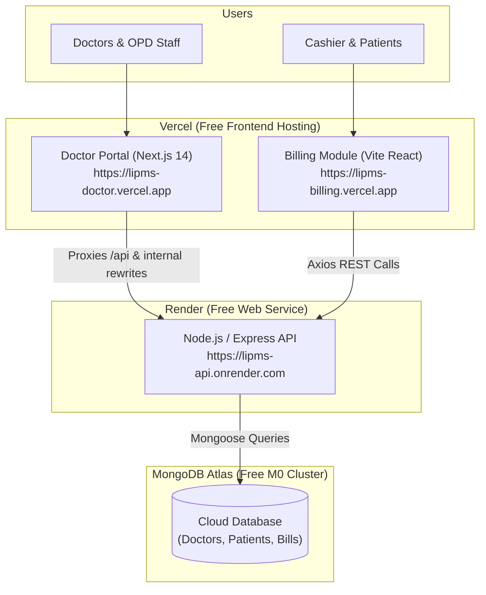

# Free-Tier Cloud Deployment Guide

This project consists of three services:
1. **Backend API (`server`)**: Node.js, Express, Mongoose, PDFKit, Razorpay simulation
2. **Billing Module (`client`)**: React 18, Vite, Tailwind CSS, Lucide icons, Framer Motion
3. **Doctor Clinical Portal (`Doctor Portal`)**: Next.js 14, Tailwind CSS

Below are the step-by-step instructions to host all 3 services for free using **MongoDB Atlas**, **Render**, and **Vercel**.

---

## Architecture Diagram



---

## Phase 1: Setup Free Cloud Database (MongoDB Atlas)

1. Go to [MongoDB Atlas](https://www.mongodb.com/cloud/atlas/register) and create a free account.
2. Create a new cluster and select **M0 (Free)**.
3. Under **Security > Database Access**:
   - Create a database user (e.g. `lipms_admin`) with a secure password.
   - Note down this password.
4. Under **Security > Network Access**:
   - Click **Add IP Address**.
   - Select **Allow Access from Anywhere** (`0.0.0.0/0`) so Render's cloud servers can connect.
5. Under **Database > Deployment**:
   - Click **Connect** > **Drivers** (Node.js).
   - Copy your connection string. It will look like:
     ```
     mongodb+srv://lipms_admin:<password>@cluster0.abcde.mongodb.net/lipms?retryWrites=true&w=majority
     ```
   - Replace `<password>` with your real password.

---

## Phase 2: Push Repository to GitHub

Open PowerShell in this folder (`D:\IMPORTANT\STUDIES\COLLEGE\MinorProject-1`):

```powershell
# 1. Stage all project files
git add .

# 2. Create the initial cloud deployment commit
git commit -m "Configure production cloud hosting for Render and Vercel"

# 3. Rename branch to main
git branch -M main

# 4. Create a new repository on https://github.com/new (e.g. lipms-hospital-system)
# Then link your remote and push (replace YOUR_USERNAME and YOUR_REPO):
git remote add origin https://github.com/YOUR_USERNAME/lipms-hospital-system.git
git push -u origin main
```

---

## Phase 3: Deploy Backend API to Render (Free Web Service)

1. Sign up / Log in to [Render](https://render.com).
2. Click **New +** > **Web Service**.
3. Connect your GitHub repository `lipms-hospital-system`.
4. Configure the Web Service settings:
   - **Name**: `lipms-backend` (or your choice)
   - **Region**: Singapore or Frankfurt (or nearest)
   - **Root Directory**: `server`
   - **Runtime**: `Node`
   - **Build Command**: `npm install`
   - **Start Command**: `node src/server.js`
   - **Instance Type**: `Free`
5. Click **Advanced > Add Environment Variable**:
   - `NODE_ENV`: `production`
   - `MONGODB_URI`: `<Your MongoDB Atlas connection string from Phase 1>`
   - `JWT_SECRET`: `<Generate a random 32-character string>`
   - `RAZORPAY_KEY_ID`: `rzp_test_TsdkF4dZuRQHa4`
   - `RAZORPAY_KEY_SECRET`: `qCINS3ara1BmyXmVYvULlZ48`
6. Click **Deploy Web Service**.
7. Once deployed, copy your live backend URL (e.g. `https://lipms-backend.onrender.com`).
   - Test it by visiting `https://lipms-backend.onrender.com/` in your browser. You will see:
     ```json
     {"status":"online","service":"LIPMS Billing & Clinical Backend API","version":"1.0.0"}
     ```

---

## Phase 4: Deploy Billing Module to Vercel

1. Log in to [Vercel](https://vercel.com).
2. Click **Add New...** > **Project**.
3. Import your GitHub repository `lipms-hospital-system`.
4. Configure the project:
   - **Project Name**: `lipms-billing`
   - **Framework Preset**: `Vite`
   - **Root Directory**: Click *Edit* and select `client`
5. Under **Environment Variables**, add:
   - `VITE_API_URL`: `https://lipms-backend.onrender.com` (Your live Render URL)
   - `VITE_DOCTOR_PORTAL_URL`: `https://lipms-doctor.vercel.app` (Your doctor portal URL from Phase 5)
6. Click **Deploy**.
7. Once deployed, copy your Billing URL (e.g. `https://lipms-billing.vercel.app`).

---

## Phase 5: Deploy Doctor Portal to Vercel

1. In [Vercel](https://vercel.com), click **Add New...** > **Project** again.
2. Select the same GitHub repository `lipms-hospital-system`.
3. Configure the project:
   - **Project Name**: `lipms-doctor`
   - **Framework Preset**: `Next.js`
   - **Root Directory**: Click *Edit* and select `Doctor Portal`
4. Under **Environment Variables**, add:
   - `BACKEND_URL`: `https://lipms-backend.onrender.com` (For Next.js `/api` proxy rewrites)
   - `NEXT_PUBLIC_API_URL`: `https://lipms-backend.onrender.com`
   - `NEXT_PUBLIC_BILLING_URL`: `https://lipms-billing.vercel.app` (From Phase 4)
5. Click **Deploy**.
6. Once deployed, copy your Doctor Portal URL (e.g. `https://lipms-doctor.vercel.app`).

---

## Phase 6: Sync Final Cross-Domain Variables

1. Go back to **Render** > `lipms-backend` > **Environment**:
   - Add/Update `CLIENT_URL`: `https://lipms-billing.vercel.app`
   - Add/Update `DOCTOR_PORTAL_URL`: `https://lipms-doctor.vercel.app`
   - Add/Update `API_URL`: `https://lipms-backend.onrender.com`
   - Save changes (Render will trigger a quick 30-second restart).
2. If you need to update `VITE_DOCTOR_PORTAL_URL` in `lipms-billing` on Vercel, update the environment variable and trigger a redeploy.

---

## Verification Checklist

- [ ] Visit Backend: `https://lipms-backend.onrender.com/` returns status `online`.
- [ ] Health check: `https://lipms-backend.onrender.com/api/health` returns status `ok`.
- [ ] Visit Doctor Portal: `https://lipms-doctor.vercel.app` loads OPD Dashboard with seeded doctors.
- [ ] Complete a Consultation: Creates a digital prescription and automatically issues a linked bill.
- [ ] Click "Open in Billing Desk": Navigates directly to `https://lipms-billing.vercel.app/bills/:id`.
- [ ] Test Payment & PDF: Generates valid PDF tax invoice and processes QR / simulated payment.
